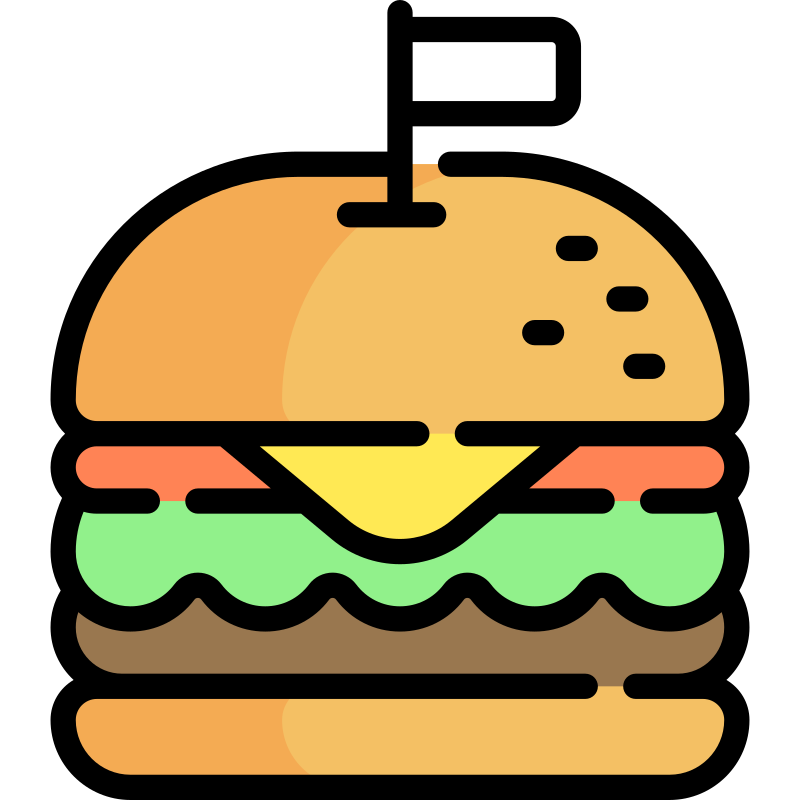
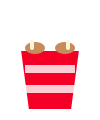

 

 

  

 

<!-- ============ 底部广告 / 联系方式 开始 ============ -->
 

  <table style="border-collapse: collapse; border: 2px dashed #F40027; border-radius: 12px; background-color: #fff8f8; width: 90%; max-width: 650px;">
    <tr>
      <td align="center" style="padding: 16px 20px 8px 20px;">
        
          🍗 V Me 50 $ 🍗
        
      </td>
    </tr>
    <tr>
      <td align="center" style="padding: 6px 20px 6px 20px; font-family: 'Fira Code', monospace; font-size: 14px; color: #333;">
        
          📢 坐下来吃一口炸鸡
        
      </td>
    </tr>
    <tr>
      <td align="center" style="padding: 10px 20px 18px 20px;">
        
        
      </td>
    </tr>
  </table>

